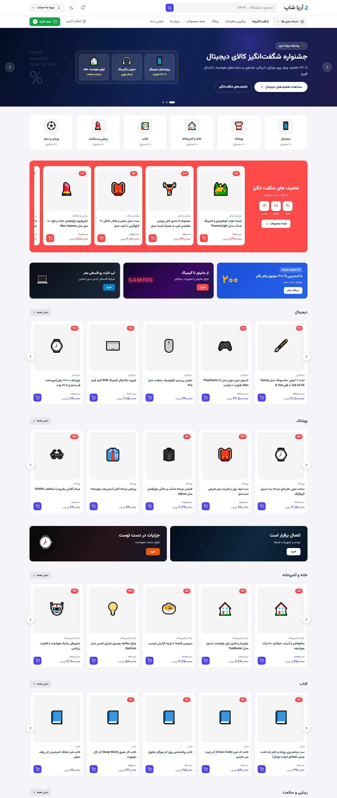
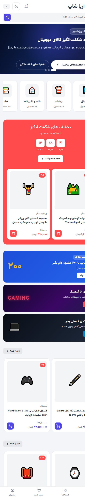
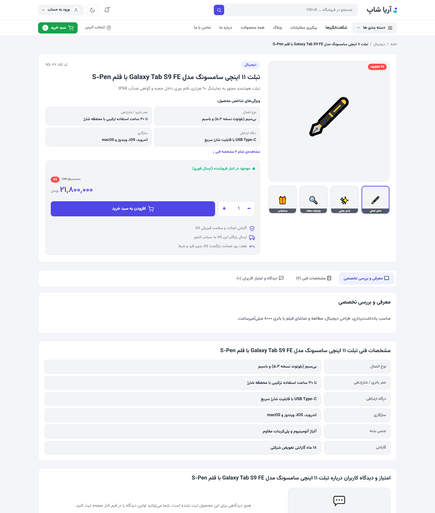
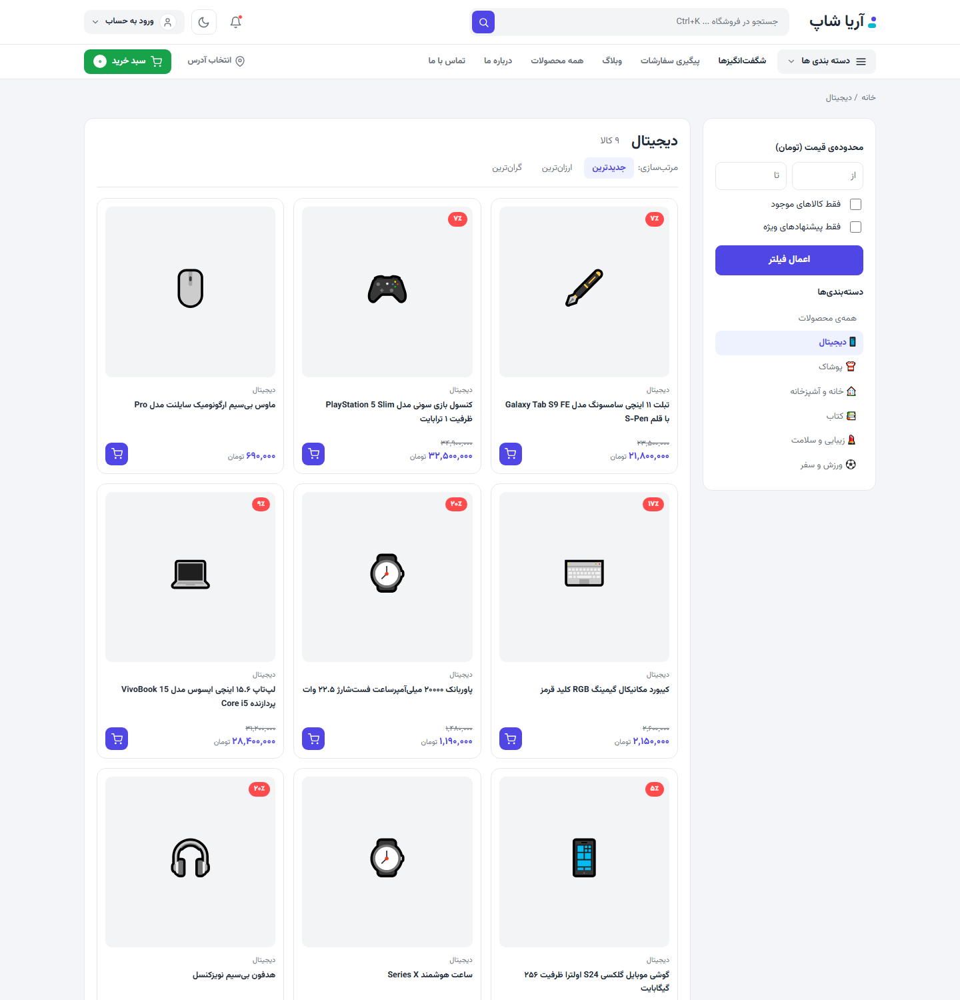
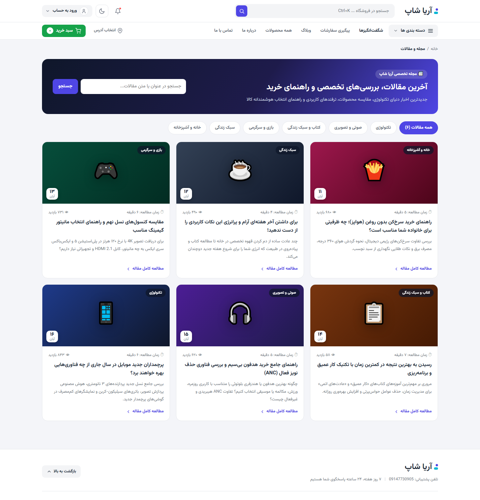
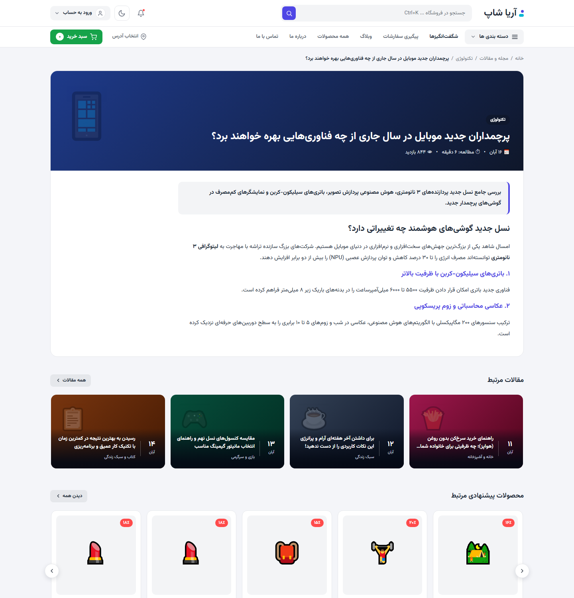
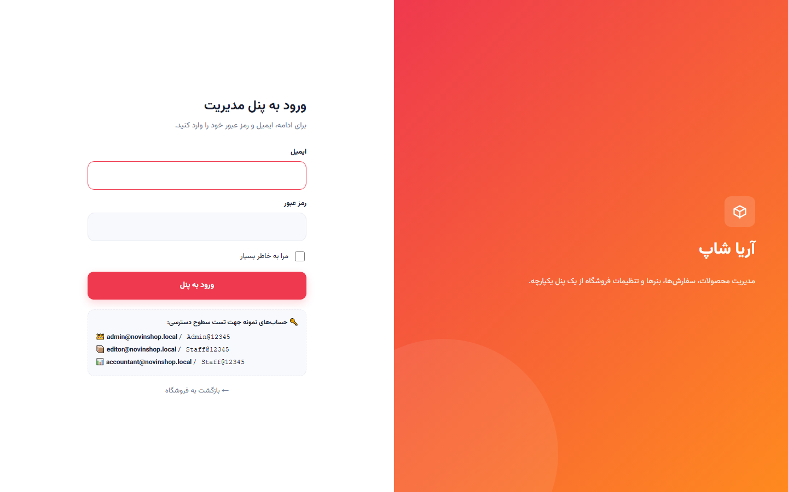

# 🛍️ نوین‌شاپ (NovinShop) — سیستم جامع فروشگاه اینترنتی ASP.NET Core 10

<div align="center">


**فروشگاه اینترنتی مدرن، سریع، فارسی و کاملاً راست‌چین (RTL) با معماری تمیز ASP.NET Core 10 MVC، پنل مدیریت ۳ لایه شبیه وردپرس، انبارداری و کاردکس کالا، حسابداری بهای تمام‌شده (COGS)، درگاه‌های پرداخت، سیستم مقالات وبلاگ و طراحی نگارشاپ (NegarShop).**

[پیش‌نمایش امکانات](#-تصاویر-محیط-پروژه) • [امکانات کلیدی](#-امکانات-کلیدی-پروژه) • [حساب‌های کاربری](#-حسابهای-کاربری-پیشفرض) • [راهنمای راه‌اندازی](#-راهنمای-اجرا-و-نصب) • [ساختار معماری](#-ساختار-فایلهای-پروژه)

</div>

---

## 📸 تصاویر محیط پروژه

### ۱. صفحه اصلی فروشگاه (طراحی NegarShop — نسخه دسکتاپ)


### ۲. صفحه اصلی (نسخه واکنش‌گرا و موبایل)
<div align="center">
  
</div>

### ۳. صفحه جزئیات کالا، مشخصات و گالری لایت‌باکس


### ۴. آرشیو دسته‌بندی کالاها و فیلترها


### ۵. مجله و مقالات وبلاگ با ویرایشگر TinyMCE 8


### ۶. مطالعه مقاله تخصصی وبلاگ و کالاهای پیشنهادی مرتبط


### ۷. ورود و احراز هویت امن


---

## ✨ امکانات کلیدی پروژه

### ۱. ویترین فروشگاهی پیشرفته (الهام‌گرفته از دمو نگارشاپ)
- **طراحی کاملاً فارسی و RTL**: تایپوگرافی زیبا با فونت وزیرمتن و متغیرهای مدرن CSS3.
- **هدر دو ردیفه مدرن**:
  - ردیف بالا: جستجوی زنده با کلید میانبر `Ctrl+K`، زنگ اعلانات، وضعیت کاربر با آواتار و خروج امن.
  - ردیف پایین: مگامنوی شناور دسته‌بندی‌ها با ناوبری بدون باگ (Hover/Click Toggle)، منوی شگفت‌انگیزها، وبلاگ، پیگیری سفارشات و دکمه سبز سبد خرید با شمارنده زنده.
- **بنر هیرو تمام‌عرض (Full-bleed Hero)** با اسلایدر خودکار و نقاط ناوبری.
- **بخش تخفیف‌های شگفت‌انگیز (Wonder Deals)**: با باکس متمایز قرمز، تایمر معکوس ثانیه‌شمار زنده فارسی و اسلایدر اسکرولی محصولات.
- **اسلایدرهای افقی ۵ کارته** برای دسته‌های مختلف (گوشی، لپ‌تاپ، لوازم جانبی و کتاب) با قابلیت جابه‌جایی با ماوس (Drag to scroll) و دکمه‌های ناوبری لبه‌ای.
- **صفحه محصول جامع**: گالری عکس چندتصویره با بزرگنمایی لایت‌باکس، محاسبه تخفیف درصدی، مشخصات فنی جدولی، ثبت دیدگاه و امتیاز ۵ ستاره.
- **حالت شب / روز (Dark / Light Mode)** با ماندگاری در LocalStorage.

---

### ۲. سطوح دسترسی چندگانه ادمین و کارمندان (مشابه وردپرس — `/Admin/Users`)
تفکیک کامل وظایف با سایدبار هوشمند و متناسب با نقش کاربر:
- 👑 **مدیر ارشد (`Admin`):** دسترسی کامل به کل سیستم، تغییر ایمیل و رمز عبور خود از پنل، ایجاد، ویرایش و عزل کارمندان، تنظیمات درگاه و پرداخت، پیکربندی عمومی.
- 📦 **کارمند محصولات و محتوا (`Editor`):** مدیریت محصولات، دسته‌بندی‌ها، انبارداری و ورود بار، مقالات وبلاگ، دیدگاه‌های کاربران و بنرها. بدون دسترسی به تنظیمات مالی، سفارشات و کارمندان.
- 📊 **حسابدار و انباردار (`Accountant`):** دسترسی مستقیم به مدیریت سفارشات، فیش‌های کارت‌به‌کارت، صدور فاکتور رسمی، کدهای تخفیف، انبارداری و گزارش‌های سود و زیان حسابداری.

---

### ۳. سیستم جامع انبارداری و کاردکس کالا (`/Admin/Inventory`)
- **حذف ویرایش دستی موجودی در فرم محصول**: موجودی کالاها صرفاً از طریق اسناد رسمی ورود و خروج انبار کنترل می‌شود.
- **انواع تراکنش‌های انبارداری**:
  - `StockIn` (ورود بار): ثبت ورود با قیمت خرید هر واحد و شماره فاکتور تأمین‌کننده.
  - `SaleOut` (کسر خودکار فروش): کسر اتوماتیک از انبار به محض تکمیل موفق خرید مشتری.
  - `ReturnIn` (مرجوعی کالا): بازگشت خودکار کالا به موجودی در صورت لغو سفارش.
  - `WasteOut` (ضایعات و خرابی) و `Adjustment` (تعدیل دوره‌ای انبارگردانی).
- **کاردکس کامل کالا**: مشاهده تاریخچه دقیق هر قلم کالا به همراه مانده موجودی لحظه‌ای.

---

### ۴. سیستم حسابداری فروشگاهی، بهای تمام‌شده و سود و زیان (`/Admin/Accounting`)
- **محاسبه هوشمند بهای تمام‌شده کالای فروش‌رفته (COGS)** بر اساس میانگین یا آخرین قیمت خرید ثبت‌شده در ورود به انبار.
- **محاسبه سود ناخالص هر سفارش و کالا**: نمایش دقیق حاشیه سود هر محصول فروخته‌شده.
- **دفتر روزنامه مالی (Journal Entries)**: ثبت هزینه‌های عملیاتی (تبلیغات، اجاره، حقوق، بسته‌بندی، بسته‌های پستی) و درآمدهای متفرقه.
- **داشبورد سود و زیان دوره‌ای**: نمایش کل فروش، بهای تمام‌شده، سود ناخالص، هزینه‌های جاری و **سود خالص نهایی**.
- **ارزش‌گذاری انبار**: محاسبه ارزش ریالی کل موجودی انبار به قیمت خرید و به قیمت فروش روز.

---

### ۵. درگاه‌های پرداخت، کارت‌به‌کارت و فاکتور چاپی
- **درگاه پرداخت آنلاین زرین‌پال (Zarinpal v4 REST API)** با قابلیت سوئیچ بین حالت تستی (`Sandbox`) و عملیاتی، اعتبارسنجی دو مرحله‌ای (`PaymentRequest` و `PaymentVerification`).
- **روش پرداخت کارت‌به‌کارت**: با امکان آپلود امن تصویر فیش بانکی توسط مشتری، شماره پیگیری و پنل اختصاصی تأیید یا رد فیش برای حسابدار.
- **سیستم کدهای تخفیف (`/Admin/Coupons`)**: درصدی و مبلغ ثابت، تعیین حداقل سبد خرید، سقف ریالی تخفیف و بازه زمانی معتبر.
- **فاکتور رسمی و برچسب پستی مرسوله (`/order/{code}/invoice`)**: طراحی تمیز، آماده پرینت با استانداردهای فاکتور فروشگاهی ایران.

---

### ۶. سامانه وبلاگ و مجله اینترنتی (`/blog` و `/Admin/Blog`)
- طراحی صفحه آرشیو مقالات با فیلتر دسته‌بندی و صفحه مقاله تک با فرمت استاندارد سئو و زمان تخمینی مطالعه.
- **ویرایشگر یکپارچه TinyMCE 8 فارسی و راست‌چین** با قابلیت Drag & Drop تصویر.
- **سیستم پاک‌سازی امن HTML (`HtmlSanitizerService`)** برای جلوگیری از حملات XSS و تزریق کد در مقالات.

---

## 🔑 حساب‌های کاربری پیش‌فرض

تمامی این حساب‌ها در اولین اجرای برنامه به‌صورت خودکار در دیتابیس ساخته و Seed می‌شوند:

| نقش کاربری | نام کاربر | ایمیل | رمز عبور | دسترسی‌های مجاز |
|---|---|---|---|---|
| 👑 **مدیر ارشد (Admin)** | مدیر کل سیستم | `admin@novinshop.local` | `Admin@12345` | دسترسی کامل به همه‌جا + مدیریت کاربران و رمزها |
| 📦 **ویرایشگر محتوا (Editor)** | کارمند بخش محتوا | `editor@novinshop.local` | `Staff@12345` | کاتالوگ، انبار، وبلاگ، نظرات |
| 📊 **حسابدار (Accountant)** | مسئول مالی و سفارشات | `accountant@novinshop.local` | `Staff@12345` | سفارشات، مالی، سود و زیان، انبار |
| 👤 **کاربر خریدار (Customer)** | اشکان رضایی | `customer@novinshop.local` | `Customer@12345` | خرید، پنل کاربری، مشاهده فاکتور |

---

## 🚀 راهنمای اجرا و نصب

### پیش‌نیازها
- نصب **[.NET 10 SDK](https://dotnet.microsoft.com/download/dotnet/10.0)** (یا نسخه 10 به بالا)

### مراحل اجرا
۱. مخزن را کلون کنید:
```bash
git clone https://github.com/ashkan0033/NovinShop.git
cd NovinShop
```

۲. پروژه را اجرا کنید:
```bash
dotnet run --project NovinShop
```

۳. مرورگر را باز کرده و به آدرس ارائه‌شده بروید:
```text
http://localhost:5000
یا
https://localhost:5001
```

> **نکته:** نیازی به نصب دیتابیس SQL Server جداگانه نیست! دیتابیس SQLite و بیش از ۴۰ کالای نمونه با تصاویر، دسته‌بندی‌ها، انبار و وبلاگ به‌صورت اتوماتیک با اولین اجرا ساخته می‌شوند.

---

## 🛠️ ساختار فایل‌های پروژه

```text
NovinShop/
├── Areas/
│   └── Admin/                    # پنل مدیریت تفکیک‌شده
│       ├── Controllers/          # کنترلرهای کاربران، انبار، حسابداری، سفارشات، وبلاگ و...
│       └── Views/                # ویوهای تمیز مدیریت با استایل مدرن
├── Controllers/                  # کنترلرهای فروشگاه (خانه، محصول، سبد، تسویه‌حساب، بلاگ، نظرات)
├── Data/
│   ├── AppDbContext.cs           # متن کانتکست دیتابیس و روابط مدل‌ها
│   ├── DbInitializer.cs          # سید اولیه داده‌ها (محصولات، انبار، کاربران، مقالات)
│   └── Migrations/               # مایگریشن‌های رسمی Entity Framework Core
├── Models/                       # انتیتی‌های سفارش، محصول، کاربر، فیش، تراکنش انبار، حسابداری و...
├── Services/                     # سرویس‌های درگاه زرین‌پال، پردازش تصویر، انبارداری و پاک‌سازی XSS
├── ViewModels/                   # مدل‌های نمایش تفکیک‌شده
├── wwwroot/
│   ├── css/                      # استایل اختصاصی سایت (site.css و admin.css)
│   ├── js/                       # اسکریپت مگامنو، لایت‌باکس، سبد خرید، تایمرها (negar-ui.js)
│   └── uploads/                  # پوشه نگهداری تصاویر محصولات، فیش‌ها و مقالات
└── docs/
    └── screenshots/              # تصاویر اسکرین‌شات داکیومنت
```

---

## 👨‍💻 توسعه‌دهنده

طراحی و پیاده‌سازی شده با ❤️ توسط **[ashkan0033](https://github.com/ashkan0033)**

اگر این پروژه برای شما کاربردی بود، خوشحال می‌شویم به آن **⭐ Star** بدهید!
